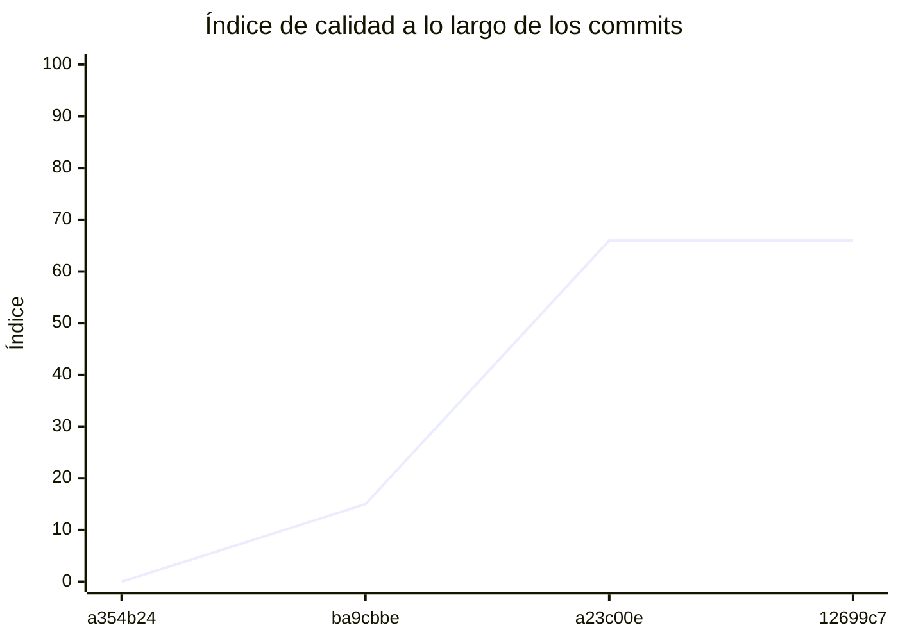

<!-- evaluacion:inicio -->
# Evaluación — Prog2-fzapata/ServicioTurnos

> Documento **generado automáticamente** por la cátedra de Programación II (UM): RepoSense + análisis de calidad de **7 dimensiones**. **No editar a mano**: se regenera en cada evaluación.
> Rama evaluada: `main`. Análisis **heurístico** (regex + métricas) + build: es una criba para orientar la revisión, **no una nota**. La **documentación** del repositorio no se evalúa.
> Generado: 2026-11-20.

## 1. Veredicto

| Aspecto | Resultado |
|---|---|
| Índice de calidad | **77/100** |
| Tipo de repositorio | `backend` |
| Build (`mvnw verify` / `gradlew check`) | OK |
| Código (LOC) | 18,748 |
| Archivos de código | 303 |
| Clases | 337 |
| Código dentro de clases (%POO) | 64% |
| Funciones fuera de clases | 0 |
| Duplicación (puerta) | 2.2% |
| Duplicación lógica | 2.3% |
| Duplicación de boilerplate | 19.8% |
| Cobertura | 99% |
| Tope duro aplicado a D1 | `POO_BAJO` → D1 ≤ 60 |

> Este informe **describe** lo que el análisis midió con los criterios ya establecidos de la materia. No es una nota.

## 2. Semáforo de aprobación

Criterios de la cátedra (`CRITERIOS-CALIDAD.md`): **Aprobar** se juega con el perfil `estandar`; **destacar**, con el `exigente` (meta de excelencia).

| Semáforo | Resultado |
|---|---|
| Aprobar (`estandar`) | **no cumple** — 7/11 |
| Destacar (`exigente`) | **no cumple** — 5/11 |

**Para aprobar, falta cumplir:** SOLID

**Para destacar, falta cumplir:** SOLID; POO; Duplicación

## 3. Autoría (RepoSense)

| Autor | Commits | Código (LOC) | Tests (LOC) | Docs (LOC) | Días activos | % del código |
|---|---:|---:|---:|---:|---:|---:|
| Franco Zapata | 57 | 6,368 | 16,286 | 888 | 18 | 100% |

> _El LOC de autoría lo calcula RepoSense sobre el historial y puede diferir del LOC de código del análisis (que mira el estado de `main`)._

## 4. Dimensiones evaluadas

Cada dimensión indica **qué mide**, **por qué importa** y **tu resultado**. Cuando el puntaje queda por debajo de la referencia, se agregan preguntas para **investigar la causa** (no hay recetas).

| Dimensión | Peso | Puntaje |
|:--|--:|--:|
| **D1** Diseño OO, SOLID y patrones (20%) | 20% | 3 |
| **D2** Arquitectura hexagonal — backend (15%) | 15% | 100 |
| **D3** Frontend KMP: MVVM y buenas prácticas (10%) | 10% | N/A |
| **D4** Integración y contrato (10%) | 10% | 90 |
| **D5** Seguridad y robustez (10%) | 10% | 100 |
| **D6** Pruebas y cobertura (20%) | 20% | 100 |
| **D7** Proceso y entrega (15%) | 15% | 100 |

### D1. Diseño OO, SOLID y patrones (20%)

- **Qué mide:** Métricas orientadas a objetos (clases, métodos, campos, cohesión, acoplamiento, herencia) y proxies de SOLID, más patrones de diseño.
- **Por qué importa:** El eje de la materia es el buen uso de la POO y su arquitectura: un diseño con clases claras y poco acopladas es más fácil de entender, probar y cambiar.
- **Tu resultado:** **3/100**
- **Para investigar la causa:**
    - ¿Se pensó el modelo de clases antes de codificar o se agrupó después?
    - ¿Qué clases concentran muchas responsabilidades a la vez?
    - ¿Los colaboradores llegan como parámetros o se crean por dentro?

### D2. Arquitectura hexagonal — backend (15%)

- **Qué mide:** Separación en capas (dominio, puertos de entrada/salida, adaptadores) y dirección de las dependencias del backend.
- **Por qué importa:** Aislar el dominio de la infraestructura permite cambiar la base de datos, el framework o el transporte sin tocar las reglas de negocio.
- **Tu resultado:** **100/100**

### D4. Integración y contrato (10%)

- **Qué mide:** Cumplimiento del contrato de integración de la cátedra (formato de errores, paginación, autenticación, endpoints esperados).
- **Por qué importa:** Los servicios deben poder integrarse entre sí y con la app sin sorpresas; el contrato es lo que hacen cumplir las pruebas de integración.
- **Tu resultado:** **90/100**

### D5. Seguridad y robustez (10%)

- **Qué mide:** Credenciales embebidas, consultas SQL por concatenación, y presencia de config de entorno; aislamiento de secretos.
- **Por qué importa:** Un secreto en el repositorio o una consulta construida por concatenación son riesgos concretos, no hipotéticos.
- **Tu resultado:** **100/100**

### D6. Pruebas y cobertura (20%)

- **Qué mide:** Cantidad y resultado de pruebas y cobertura de línea (JaCoCo/Kover, Surefire/Failsafe) cuando hay build.
- **Por qué importa:** Las pruebas son la red de seguridad para refactorizar e integrar; la cobertura acota las zonas sin verificar.
- **Tu resultado:** **100/100**

### D7. Proceso y entrega (15%)

- **Qué mide:** Artefactos verificables de proceso/entrega: `compose`, `.env.example`, CI (`.github/workflows/`), `CODEOWNERS` y wrapper de build (`mvnw`/`gradlew`). **No** puntúa documentación.
- **Por qué importa:** Un proyecto que compila, se levanta y se valida solo es más fácil de revisar y de integrar en equipo.
- **Tu resultado:** **100/100**

## 5. Señales detectadas

El análisis encontró las siguientes señales, con el archivo y la línea donde se originan cuando están disponibles:

**Archivos con más señales**

| Archivo | Señales |
|---|---:|
| `src/main/java/ar/edu/um/prog2/fzapata/turnos/reserva/application/usecases/StartReservationUseCaseImpl.java` | 6 |
| `src/main/java/ar/edu/um/prog2/fzapata/turnos/reserva/infrastructure/logging/ExpirationRoundLogger.java` | 4 |
| `src/main/java/ar/edu/um/prog2/fzapata/turnos/reserva/infrastructure/client/CatedraApiClientAdapter.java` | 4 |
| `src/main/java/ar/edu/um/prog2/fzapata/turnos/reserva/infrastructure/client/CatalogClientAdapter.java` | 4 |
| `src/main/java/ar/edu/um/prog2/fzapata/turnos/reserva/application/service/ReservaService.java` | 4 |
| `src/main/java/ar/edu/um/prog2/fzapata/turnos/reserva/domain/model/CatedraEvent.java` | 4 |
| `src/main/java/ar/edu/um/prog2/fzapata/turnos/reserva/infrastructure/logging/TransitionOutcomeLogger.java` | 3 |
| `src/main/java/ar/edu/um/prog2/fzapata/turnos/reserva/infrastructure/kafka/KafkaPhonePublisher.java` | 3 |
| `src/main/java/ar/edu/um/prog2/fzapata/turnos/reserva/infrastructure/client/CatedraErrorTranslator.java` | 3 |
| `src/main/java/ar/edu/um/prog2/fzapata/turnos/reserva/infrastructure/sse/ReservationStreamRegistry.java` | 3 |

**DIP/concretos** (80)
- clase 'ReservaService' muy acoplada (CBO=38) — `src/main/java/ar/edu/um/prog2/fzapata/turnos/reserva/application/service/ReservaService.java:42`
- clase 'ReservaService' instancia 6 concretos (CBO=38) — `src/main/java/ar/edu/um/prog2/fzapata/turnos/reserva/application/service/ReservaService.java:42`
- clase 'ApplyReservationTransitionUseCaseImpl' muy acoplada (CBO=28) — `src/main/java/ar/edu/um/prog2/fzapata/turnos/reserva/application/usecases/ApplyReservationTransitionUseCaseImpl.java:24`
- clase 'ApplyReservationTransitionUseCaseImpl' instancia 4 concretos (CBO=28) — `src/main/java/ar/edu/um/prog2/fzapata/turnos/reserva/application/usecases/ApplyReservationTransitionUseCaseImpl.java:24`
- clase 'CancelReservationUseCaseImpl' muy acoplada (CBO=21) — `src/main/java/ar/edu/um/prog2/fzapata/turnos/reserva/application/usecases/CancelReservationUseCaseImpl.java:27`
- clase 'CancelReservationUseCaseImpl' instancia 5 concretos (CBO=21) — `src/main/java/ar/edu/um/prog2/fzapata/turnos/reserva/application/usecases/CancelReservationUseCaseImpl.java:27`
- clase 'CatedraReconciliation' muy acoplada (CBO=27) — `src/main/java/ar/edu/um/prog2/fzapata/turnos/reserva/application/usecases/CatedraReconciliation.java:30`
- clase 'CatedraReconciliation' instancia 3 concretos (CBO=27) — `src/main/java/ar/edu/um/prog2/fzapata/turnos/reserva/application/usecases/CatedraReconciliation.java:30`
- clase 'ExpireOverdueReservationsUseCaseImpl' muy acoplada (CBO=27) — `src/main/java/ar/edu/um/prog2/fzapata/turnos/reserva/application/usecases/ExpireOverdueReservationsUseCaseImpl.java:24`
- clase 'GetAvailabilityUseCaseImpl' muy acoplada (CBO=15) — `src/main/java/ar/edu/um/prog2/fzapata/turnos/reserva/application/usecases/GetAvailabilityUseCaseImpl.java:24`
- clase 'HoldRejectionTranslator' muy acoplada (CBO=13) — `src/main/java/ar/edu/um/prog2/fzapata/turnos/reserva/application/usecases/HoldRejectionTranslator.java:12`
- clase 'HoldRejectionTranslator' instancia 5 concretos (CBO=13) — `src/main/java/ar/edu/um/prog2/fzapata/turnos/reserva/application/usecases/HoldRejectionTranslator.java:12`
- clase 'ListReservationsUseCaseImpl' muy acoplada (CBO=8) — `src/main/java/ar/edu/um/prog2/fzapata/turnos/reserva/application/usecases/ListReservationsUseCaseImpl.java:16`
- clase 'MarkPhoneSentUseCaseImpl' muy acoplada (CBO=20) — `src/main/java/ar/edu/um/prog2/fzapata/turnos/reserva/application/usecases/MarkPhoneSentUseCaseImpl.java:24`
- clase 'MarkPhoneSentUseCaseImpl' instancia 3 concretos (CBO=20) — `src/main/java/ar/edu/um/prog2/fzapata/turnos/reserva/application/usecases/MarkPhoneSentUseCaseImpl.java:24`
- clase 'ProcessCatedraEventUseCaseImpl' muy acoplada (CBO=18) — `src/main/java/ar/edu/um/prog2/fzapata/turnos/reserva/application/usecases/ProcessCatedraEventUseCaseImpl.java:25`
- clase 'PublishPendingPhonesUseCaseImpl' muy acoplada (CBO=12) — `src/main/java/ar/edu/um/prog2/fzapata/turnos/reserva/application/usecases/PublishPendingPhonesUseCaseImpl.java:25`
- clase 'RecoverReservationsUseCaseImpl' muy acoplada (CBO=30) — `src/main/java/ar/edu/um/prog2/fzapata/turnos/reserva/application/usecases/RecoverReservationsUseCaseImpl.java:25`
- clase 'StartReservationUseCaseImpl' muy acoplada (CBO=70) — `src/main/java/ar/edu/um/prog2/fzapata/turnos/reserva/application/usecases/StartReservationUseCaseImpl.java:43`
- clase 'StartReservationUseCaseImpl' instancia 9 concretos (CBO=70) — `src/main/java/ar/edu/um/prog2/fzapata/turnos/reserva/application/usecases/StartReservationUseCaseImpl.java:43`
- clase 'SubmitPhoneUseCaseImpl' muy acoplada (CBO=29) — `src/main/java/ar/edu/um/prog2/fzapata/turnos/reserva/application/usecases/SubmitPhoneUseCaseImpl.java:34`
- clase 'SubmitPhoneUseCaseImpl' instancia 5 concretos (CBO=29) — `src/main/java/ar/edu/um/prog2/fzapata/turnos/reserva/application/usecases/SubmitPhoneUseCaseImpl.java:34`
- clase 'AgendaSlots' muy acoplada (CBO=17) — `src/main/java/ar/edu/um/prog2/fzapata/turnos/reserva/domain/model/AgendaSlots.java:13`
- clase 'CatedraEvent' muy acoplada (CBO=16) — `src/main/java/ar/edu/um/prog2/fzapata/turnos/reserva/domain/model/CatedraEvent.java:9`
- clase 'CatedraEventType' muy acoplada (CBO=12) — `src/main/java/ar/edu/um/prog2/fzapata/turnos/reserva/domain/model/CatedraEventType.java:8`
- clase 'CatedraRejection' muy acoplada (CBO=13) — `src/main/java/ar/edu/um/prog2/fzapata/turnos/reserva/domain/model/CatedraRejection.java:5`
- clase 'ReservationStatus' muy acoplada (CBO=17) — `src/main/java/ar/edu/um/prog2/fzapata/turnos/reserva/domain/model/ReservationStatus.java:7`
- clase 'ApplyReservationTransitionUseCase' muy acoplada (CBO=8) — `src/main/java/ar/edu/um/prog2/fzapata/turnos/reserva/domain/ports/in/ApplyReservationTransitionUseCase.java:8`
- clase 'ListReservationsUseCase' muy acoplada (CBO=8) — `src/main/java/ar/edu/um/prog2/fzapata/turnos/reserva/domain/ports/in/ListReservationsUseCase.java:8`
- clase 'RecoverReservationsUseCase' muy acoplada (CBO=10) — `src/main/java/ar/edu/um/prog2/fzapata/turnos/reserva/domain/ports/in/RecoverReservationsUseCase.java:8`
- clase 'CatedraApiClient' muy acoplada (CBO=15) — `src/main/java/ar/edu/um/prog2/fzapata/turnos/reserva/domain/ports/out/CatedraApiClient.java:17`
- clase 'ReservationProcessRepository' muy acoplada (CBO=15) — `src/main/java/ar/edu/um/prog2/fzapata/turnos/reserva/domain/ports/out/ReservationProcessRepository.java:12`
- clase 'CatalogClientAdapter' muy acoplada (CBO=26) — `src/main/java/ar/edu/um/prog2/fzapata/turnos/reserva/infrastructure/client/CatalogClientAdapter.java:27`
- clase 'CatalogClientAdapter' instancia 6 concretos (CBO=26) — `src/main/java/ar/edu/um/prog2/fzapata/turnos/reserva/infrastructure/client/CatalogClientAdapter.java:27`
- clase 'CatedraApiClientAdapter' muy acoplada (CBO=41) — `src/main/java/ar/edu/um/prog2/fzapata/turnos/reserva/infrastructure/client/CatedraApiClientAdapter.java:39`
- clase 'CatedraApiClientAdapter' instancia 6 concretos (CBO=41) — `src/main/java/ar/edu/um/prog2/fzapata/turnos/reserva/infrastructure/client/CatedraApiClientAdapter.java:39`
- clase 'CatedraErrorTranslator' muy acoplada (CBO=37) — `src/main/java/ar/edu/um/prog2/fzapata/turnos/reserva/infrastructure/client/CatedraErrorTranslator.java:24`
- clase 'CatedraErrorTranslator' instancia 7 concretos (CBO=37) — `src/main/java/ar/edu/um/prog2/fzapata/turnos/reserva/infrastructure/client/CatedraErrorTranslator.java:24`
- clase 'CatedraMapper' muy acoplada (CBO=12) — `src/main/java/ar/edu/um/prog2/fzapata/turnos/reserva/infrastructure/client/CatedraMapper.java:20`
- clase 'CatalogClientConfiguration' muy acoplada (CBO=14) — `src/main/java/ar/edu/um/prog2/fzapata/turnos/reserva/infrastructure/config/CatalogClientConfiguration.java:20`
- clase 'CatedraClientConfiguration' muy acoplada (CBO=18) — `src/main/java/ar/edu/um/prog2/fzapata/turnos/reserva/infrastructure/config/CatedraClientConfiguration.java:21`
- clase 'CatedraEventListener' muy acoplada (CBO=9) — `src/main/java/ar/edu/um/prog2/fzapata/turnos/reserva/infrastructure/kafka/CatedraEventListener.java:15`
- clase 'CatedraEventMapper' muy acoplada (CBO=8) — `src/main/java/ar/edu/um/prog2/fzapata/turnos/reserva/infrastructure/kafka/CatedraEventMapper.java:11`
- clase 'CatedraEventMapper' instancia 6 concretos (CBO=8) — `src/main/java/ar/edu/um/prog2/fzapata/turnos/reserva/infrastructure/kafka/CatedraEventMapper.java:11`
- clase 'CatedraKafkaErrorHandlerConfiguration' muy acoplada (CBO=8) — `src/main/java/ar/edu/um/prog2/fzapata/turnos/reserva/infrastructure/kafka/CatedraKafkaErrorHandlerConfiguration.java:11`
- clase 'JsonPhoneMessageSerializer' muy acoplada (CBO=8) — `src/main/java/ar/edu/um/prog2/fzapata/turnos/reserva/infrastructure/kafka/JsonPhoneMessageSerializer.java:12`
- clase 'KafkaPhonePublisher' muy acoplada (CBO=14) — `src/main/java/ar/edu/um/prog2/fzapata/turnos/reserva/infrastructure/kafka/KafkaPhonePublisher.java:20`
- clase 'KafkaPhonePublisher' instancia 3 concretos (CBO=14) — `src/main/java/ar/edu/um/prog2/fzapata/turnos/reserva/infrastructure/kafka/KafkaPhonePublisher.java:20`
- clase 'EventResultLogger' muy acoplada (CBO=18) — `src/main/java/ar/edu/um/prog2/fzapata/turnos/reserva/infrastructure/logging/EventResultLogger.java:19`
- clase 'ExpirationRoundLogger' muy acoplada (CBO=10) — `src/main/java/ar/edu/um/prog2/fzapata/turnos/reserva/infrastructure/logging/ExpirationRoundLogger.java:14`
- clase 'RecoveryRoundLogger' muy acoplada (CBO=11) — `src/main/java/ar/edu/um/prog2/fzapata/turnos/reserva/infrastructure/logging/RecoveryRoundLogger.java:14`
- clase 'TransitionOutcomeLogger' muy acoplada (CBO=10) — `src/main/java/ar/edu/um/prog2/fzapata/turnos/reserva/infrastructure/logging/TransitionOutcomeLogger.java:15`
- clase 'JpaReservationProcessRepositoryAdapter' muy acoplada (CBO=25) — `src/main/java/ar/edu/um/prog2/fzapata/turnos/reserva/infrastructure/persistence/adapter/JpaReservationProcessRepositoryAdapter.java:27`
- clase 'ReservationProcessEntity' muy acoplada (CBO=11) — `src/main/java/ar/edu/um/prog2/fzapata/turnos/reserva/infrastructure/persistence/entity/ReservationProcessEntity.java:29`
- clase 'JpaReservationProcessRepository' muy acoplada (CBO=9) — `src/main/java/ar/edu/um/prog2/fzapata/turnos/reserva/infrastructure/persistence/repository/JpaReservationProcessRepository.java:19`
- clase 'ExpirationScheduler' muy acoplada (CBO=10) — `src/main/java/ar/edu/um/prog2/fzapata/turnos/reserva/infrastructure/scheduling/ExpirationScheduler.java:24`
- clase 'OutboxRelayScheduler' muy acoplada (CBO=11) — `src/main/java/ar/edu/um/prog2/fzapata/turnos/reserva/infrastructure/scheduling/OutboxRelayScheduler.java:24`
- clase 'StreamHeartbeatScheduler' muy acoplada (CBO=8) — `src/main/java/ar/edu/um/prog2/fzapata/turnos/reserva/infrastructure/scheduling/StreamHeartbeatScheduler.java:20`
- clase 'ReservationStreamRegistry' muy acoplada (CBO=18) — `src/main/java/ar/edu/um/prog2/fzapata/turnos/reserva/infrastructure/sse/ReservationStreamRegistry.java:28`
- clase 'SseReservationChangePublisher' muy acoplada (CBO=14) — `src/main/java/ar/edu/um/prog2/fzapata/turnos/reserva/infrastructure/sse/SseReservationChangePublisher.java:17`
- clase 'AvailabilityController' muy acoplada (CBO=14) — `src/main/java/ar/edu/um/prog2/fzapata/turnos/reserva/infrastructure/web/controller/AvailabilityController.java:23`
- clase 'ReservationController' muy acoplada (CBO=39) — `src/main/java/ar/edu/um/prog2/fzapata/turnos/reserva/infrastructure/web/controller/ReservationController.java:41`
- clase 'ReservationStreamController' muy acoplada (CBO=13) — `src/main/java/ar/edu/um/prog2/fzapata/turnos/reserva/infrastructure/web/controller/ReservationStreamController.java:21`
- clase 'ReservaExceptionHandler' muy acoplada (CBO=44) — `src/main/java/ar/edu/um/prog2/fzapata/turnos/reserva/infrastructure/web/handler/ReservaExceptionHandler.java:35`
- clase 'AvailabilityQueryMapper' muy acoplada (CBO=8) — `src/main/java/ar/edu/um/prog2/fzapata/turnos/reserva/infrastructure/web/mapper/AvailabilityQueryMapper.java:15`
- clase 'AvailabilityQueryMapper' instancia 3 concretos (CBO=8) — `src/main/java/ar/edu/um/prog2/fzapata/turnos/reserva/infrastructure/web/mapper/AvailabilityQueryMapper.java:15`
- clase 'ReservationDtoMapper' muy acoplada (CBO=11) — `src/main/java/ar/edu/um/prog2/fzapata/turnos/reserva/infrastructure/web/mapper/ReservationDtoMapper.java:15`
- clase 'CatedraProperties' muy acoplada (CBO=12) — `src/main/java/ar/edu/um/prog2/fzapata/turnos/shared/config/CatedraProperties.java:17`
- clase 'JwtConfiguration' muy acoplada (CBO=16) — `src/main/java/ar/edu/um/prog2/fzapata/turnos/shared/security/JwtConfiguration.java:20`
- clase 'JwtConfiguration' instancia 5 concretos (CBO=16) — `src/main/java/ar/edu/um/prog2/fzapata/turnos/shared/security/JwtConfiguration.java:20`
- clase 'JwtPropagationInterceptor' muy acoplada (CBO=12) — `src/main/java/ar/edu/um/prog2/fzapata/turnos/shared/security/JwtPropagationInterceptor.java:16`
- clase 'OpenApiConfiguration' muy acoplada (CBO=14) — `src/main/java/ar/edu/um/prog2/fzapata/turnos/shared/security/OpenApiConfiguration.java:12`
- clase 'OpenApiConfiguration' instancia 3 concretos (CBO=14) — `src/main/java/ar/edu/um/prog2/fzapata/turnos/shared/security/OpenApiConfiguration.java:12`
- clase 'ProblemDetailsSecurityHandler' muy acoplada (CBO=19) — `src/main/java/ar/edu/um/prog2/fzapata/turnos/shared/security/ProblemDetailsSecurityHandler.java:26`
- clase 'RequiredClaimsValidator' muy acoplada (CBO=8) — `src/main/java/ar/edu/um/prog2/fzapata/turnos/shared/security/RequiredClaimsValidator.java:12`
- clase 'SecurityConfiguration' muy acoplada (CBO=19) — `src/main/java/ar/edu/um/prog2/fzapata/turnos/shared/security/SecurityConfiguration.java:17`
- clase 'GlobalExceptionHandler' muy acoplada (CBO=27) — `src/main/java/ar/edu/um/prog2/fzapata/turnos/shared/web/GlobalExceptionHandler.java:32`
- clase 'PaginationHeaders' muy acoplada (CBO=8) — `src/main/java/ar/edu/um/prog2/fzapata/turnos/shared/web/PaginationHeaders.java:12`
- clase 'ProblemDetailsFactory' muy acoplada (CBO=27) — `src/main/java/ar/edu/um/prog2/fzapata/turnos/shared/web/ProblemDetailsFactory.java:12`
- clase 'ProblemDetailsFactory' instancia 7 concretos (CBO=27) — `src/main/java/ar/edu/um/prog2/fzapata/turnos/shared/web/ProblemDetailsFactory.java:12`

**SRP/responsabilidad** (33)
- clase 'ReservaService' grande (LOC=68, métodos=12, campos=12) — `src/main/java/ar/edu/um/prog2/fzapata/turnos/reserva/application/service/ReservaService.java:42`
- clase 'ReservaService' con baja cohesión (0%) — `src/main/java/ar/edu/um/prog2/fzapata/turnos/reserva/application/service/ReservaService.java:42`
- clase 'ApplyReservationTransitionUseCaseImpl' con baja cohesión (40%) — `src/main/java/ar/edu/um/prog2/fzapata/turnos/reserva/application/usecases/ApplyReservationTransitionUseCaseImpl.java:24`
- clase 'CatedraReconciliation' con baja cohesión (0%) — `src/main/java/ar/edu/um/prog2/fzapata/turnos/reserva/application/usecases/CatedraReconciliation.java:30`
- clase 'RecoverReservationsUseCaseImpl' con baja cohesión (40%) — `src/main/java/ar/edu/um/prog2/fzapata/turnos/reserva/application/usecases/RecoverReservationsUseCaseImpl.java:25`
- clase 'StartReservationUseCaseImpl' grande (LOC=193, métodos=13, campos=11) — `src/main/java/ar/edu/um/prog2/fzapata/turnos/reserva/application/usecases/StartReservationUseCaseImpl.java:43`
- clase 'StartReservationUseCaseImpl' con baja cohesión (9%) — `src/main/java/ar/edu/um/prog2/fzapata/turnos/reserva/application/usecases/StartReservationUseCaseImpl.java:43`
- método 'StartReservationUseCaseImpl.startReservation' de 31 líneas — `src/main/java/ar/edu/um/prog2/fzapata/turnos/reserva/application/usecases/StartReservationUseCaseImpl.java:76`
- método 'StartReservationUseCaseImpl.startReservation' con complejidad 6 — `src/main/java/ar/edu/um/prog2/fzapata/turnos/reserva/application/usecases/StartReservationUseCaseImpl.java:76`
- método 'CatedraEvent.CatedraEvent' con 6 parámetros — `src/main/java/ar/edu/um/prog2/fzapata/turnos/reserva/domain/model/CatedraEvent.java:9`
- método 'CatedraEvent.CatedraEvent' con complejidad 7 — `src/main/java/ar/edu/um/prog2/fzapata/turnos/reserva/domain/model/CatedraEvent.java:9`
- método 'CatedraEvent.toTransition' con complejidad 7 — `src/main/java/ar/edu/um/prog2/fzapata/turnos/reserva/domain/model/CatedraEvent.java:20`
- método 'PhoneSubmission.PhoneSubmission' con 6 parámetros — `src/main/java/ar/edu/um/prog2/fzapata/turnos/reserva/domain/model/PhoneSubmission.java:7`
- clase 'ReservationStatus' con baja cohesión (0%) — `src/main/java/ar/edu/um/prog2/fzapata/turnos/reserva/domain/model/ReservationStatus.java:7`
- método 'ReservationStatus.canTransitionTo' con complejidad 8 — `src/main/java/ar/edu/um/prog2/fzapata/turnos/reserva/domain/model/ReservationStatus.java:46`
- método 'ReservationTransition.ReservationTransition' con 9 parámetros — `src/main/java/ar/edu/um/prog2/fzapata/turnos/reserva/domain/model/ReservationTransition.java:11`
- clase 'CatalogClientAdapter' con baja cohesión (13%) — `src/main/java/ar/edu/um/prog2/fzapata/turnos/reserva/infrastructure/client/CatalogClientAdapter.java:27`
- clase 'CatedraApiClientAdapter' grande (LOC=115, métodos=20, campos=5) — `src/main/java/ar/edu/um/prog2/fzapata/turnos/reserva/infrastructure/client/CatedraApiClientAdapter.java:39`
- clase 'CatedraApiClientAdapter' con baja cohesión (8%) — `src/main/java/ar/edu/um/prog2/fzapata/turnos/reserva/infrastructure/client/CatedraApiClientAdapter.java:39`
- método 'CatedraEventMessage.CatedraEventMessage' con 6 parámetros — `src/main/java/ar/edu/um/prog2/fzapata/turnos/reserva/infrastructure/kafka/dto/CatedraEventMessage.java:7`
- método 'PhoneSubmittedMessage.PhoneSubmittedMessage' con 9 parámetros — `src/main/java/ar/edu/um/prog2/fzapata/turnos/reserva/infrastructure/kafka/dto/PhoneSubmittedMessage.java:7`
- método 'EventResultLogger.log' con complejidad 6 — `src/main/java/ar/edu/um/prog2/fzapata/turnos/reserva/infrastructure/logging/EventResultLogger.java:23`
- método 'ExpirationRoundLogger.log' con complejidad 7 — `src/main/java/ar/edu/um/prog2/fzapata/turnos/reserva/infrastructure/logging/ExpirationRoundLogger.java:16`
- método 'RecoveryRoundLogger.log' con complejidad 8 — `src/main/java/ar/edu/um/prog2/fzapata/turnos/reserva/infrastructure/logging/RecoveryRoundLogger.java:16`
- método 'TransitionOutcomeLogger.log' con complejidad 6 — `src/main/java/ar/edu/um/prog2/fzapata/turnos/reserva/infrastructure/logging/TransitionOutcomeLogger.java:18`
- método 'TransitionOutcomeLogger.described' con 5 parámetros — `src/main/java/ar/edu/um/prog2/fzapata/turnos/reserva/infrastructure/logging/TransitionOutcomeLogger.java:42`
- clase 'ReservationStreamRegistry' grande (LOC=95, métodos=12, campos=6) — `src/main/java/ar/edu/um/prog2/fzapata/turnos/reserva/infrastructure/sse/ReservationStreamRegistry.java:28`
- clase 'ReservationStreamRegistry' con baja cohesión (27%) — `src/main/java/ar/edu/um/prog2/fzapata/turnos/reserva/infrastructure/sse/ReservationStreamRegistry.java:28`
- método 'ReservationUpdate.ReservationUpdate' con 5 parámetros — `src/main/java/ar/edu/um/prog2/fzapata/turnos/reserva/infrastructure/sse/ReservationUpdate.java:8`
- clase 'ReservaExceptionHandler' grande (LOC=87, métodos=14, campos=1) — `src/main/java/ar/edu/um/prog2/fzapata/turnos/reserva/infrastructure/web/handler/ReservaExceptionHandler.java:35`
- método 'CatedraProperties.CatedraProperties' con 5 parámetros — `src/main/java/ar/edu/um/prog2/fzapata/turnos/shared/config/CatedraProperties.java:17`
- método 'GlobalExceptionHandler.handleExceptionInternal' con 5 parámetros — `src/main/java/ar/edu/um/prog2/fzapata/turnos/shared/web/GlobalExceptionHandler.java:58`
- método 'ProblemDetailsFactory.standardFor' con complejidad 7 — `src/main/java/ar/edu/um/prog2/fzapata/turnos/shared/web/ProblemDetailsFactory.java:56`

**LSP/overrides** (3)
- 'KafkaPhonePublisher.publish' vacío o 'no implementado' — `src/main/java/ar/edu/um/prog2/fzapata/turnos/reserva/infrastructure/kafka/KafkaPhonePublisher.java:26`
- 'PhoneDeliveryLogger.log' vacío o 'no implementado' — `src/main/java/ar/edu/um/prog2/fzapata/turnos/reserva/infrastructure/logging/PhoneDeliveryLogger.java:23`
- 'JwtPropagationInterceptor.intercept' vacío o 'no implementado' — `src/main/java/ar/edu/um/prog2/fzapata/turnos/shared/security/JwtPropagationInterceptor.java:19`

**OCP/type-switch** (4)
- clase 'CatalogClientAdapter' con 2 type-checks — `src/main/java/ar/edu/um/prog2/fzapata/turnos/reserva/infrastructure/client/CatalogClientAdapter.java:27`
- clase 'CatedraErrorTranslator' con 2 type-checks — `src/main/java/ar/edu/um/prog2/fzapata/turnos/reserva/infrastructure/client/CatedraErrorTranslator.java:24`
- clase 'JwtPropagationInterceptor' con 1 type-checks — `src/main/java/ar/edu/um/prog2/fzapata/turnos/shared/security/JwtPropagationInterceptor.java:16`
- clase 'GlobalExceptionHandler' con 2 type-checks — `src/main/java/ar/edu/um/prog2/fzapata/turnos/shared/web/GlobalExceptionHandler.java:32`

**?** (1)
- clase 'CatedraNotReachedException' con herencia profunda (DIT=2) — `src/main/java/ar/edu/um/prog2/fzapata/turnos/reserva/application/exception/CatedraNotReachedException.java:5`

**duplicación** (6)
- duplicación lógica: 2.2% · boilerplate: 19.8%
- bloque de 8 líneas repetido 2 veces en src/main/java/ar/edu/um/prog2/fzapata/turnos/reserva/infrastructure/logging/ExpirationRoundLogger.java:21, src/main/java/ar/edu/um/prog2/fzapata/turnos/reserva/infrastructure/logging/RecoveryRoundLogger.java:24 — `src/main/java/ar/edu/um/prog2/fzapata/turnos/reserva/infrastructure/logging/ExpirationRoundLogger.java:21`
- bloque de 8 líneas repetido 2 veces en src/main/java/ar/edu/um/prog2/fzapata/turnos/reserva/infrastructure/logging/ExpirationRoundLogger.java:23, src/main/java/ar/edu/um/prog2/fzapata/turnos/reserva/infrastructure/logging/RecoveryRoundLogger.java:26 — `src/main/java/ar/edu/um/prog2/fzapata/turnos/reserva/infrastructure/logging/ExpirationRoundLogger.java:23`
- bloque de 8 líneas repetido 2 veces en src/test/java/ar/edu/um/prog2/fzapata/turnos/reserva/StartReservationIntegrationTest.java:146, src/test/java/ar/edu/um/prog2/fzapata/turnos/reserva/infrastructure/web/controller/ReservationControllerTest.java:139 — `src/test/java/ar/edu/um/prog2/fzapata/turnos/reserva/StartReservationIntegrationTest.java:146`
- bloque de 8 líneas repetido 6 veces en src/test/java/ar/edu/um/prog2/fzapata/turnos/reserva/infrastructure/client/CatedraApiClientAdapterTest.java:499, src/test/java/ar/edu/um/prog2/fzapata/turnos/reserva/infrastructure/client/CatedraApiClientAdapterTest.java:500, src/test/java/ar/edu/um/prog2/fzapata/turnos/reserva/domain/model/PhoneNumberTest.java:37 — `src/test/java/ar/edu/um/prog2/fzapata/turnos/reserva/infrastructure/client/CatedraApiClientAdapterTest.java:499`
- bloque de 8 líneas repetido 2 veces en src/test/java/ar/edu/um/prog2/fzapata/turnos/reserva/infrastructure/client/CatedraApiClientAdapterTest.java:501, src/test/java/ar/edu/um/prog2/fzapata/turnos/reserva/domain/model/PhoneNumberTest.java:41 — `src/test/java/ar/edu/um/prog2/fzapata/turnos/reserva/infrastructure/client/CatedraApiClientAdapterTest.java:501`

## 6. Evolución por commit

Métricas calculadas sobre el estado de `main` en **cada commit** (4 commits con trabajo), del primero al último. La calidad usa el perfil `exigente`; el aporte de código lo mide RepoSense. El índice puede **bajar** al crecer el proyecto: se acumulan señales.

| # | Fecha | Commit | Autor | LOC | Índice | %POO | Duplic. | Sueltas |
|---|---|---|---|---:|---:|---:|---:|---:|
| 1 | 2026-09-07 | `a354b24` | Franco Zapata | 0 | 0 | 0% | 0.0% | 0 |
| 2 | 2026-09-10 | `ba9cbbe` | Ing. Daniel Quinteros | 0 | 15 | 0% | 0.0% | 0 |
| 3 | 2026-11-17 | `a23c00e` | Franco Zapata | 18,119 | 66 | 64% | 2.1% | 0 |
| 4 | 2026-11-18 | `12699c7` | Franco Zapata | 18,748 | 66 | 64% | 2.2% | 0 |

---
_Informe generado por la cátedra. Las dimensiones y umbrales corresponden a `calidad.py` (perfil `exigente`); el semáforo, a `CRITERIOS-CALIDAD.md`. La documentación del repositorio no se evalúa. Ante dudas, revisá el archivo señalado._
<!-- evaluacion:fin -->
