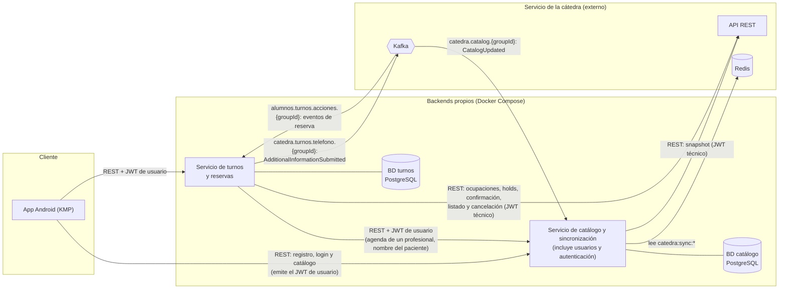
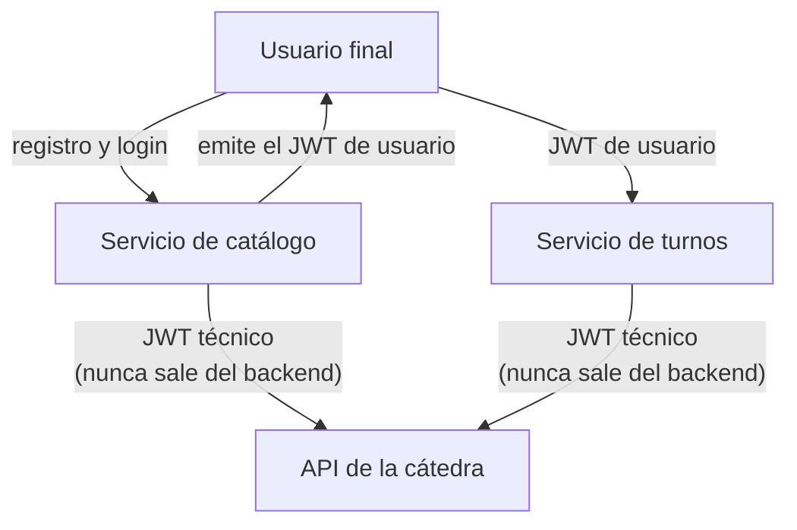
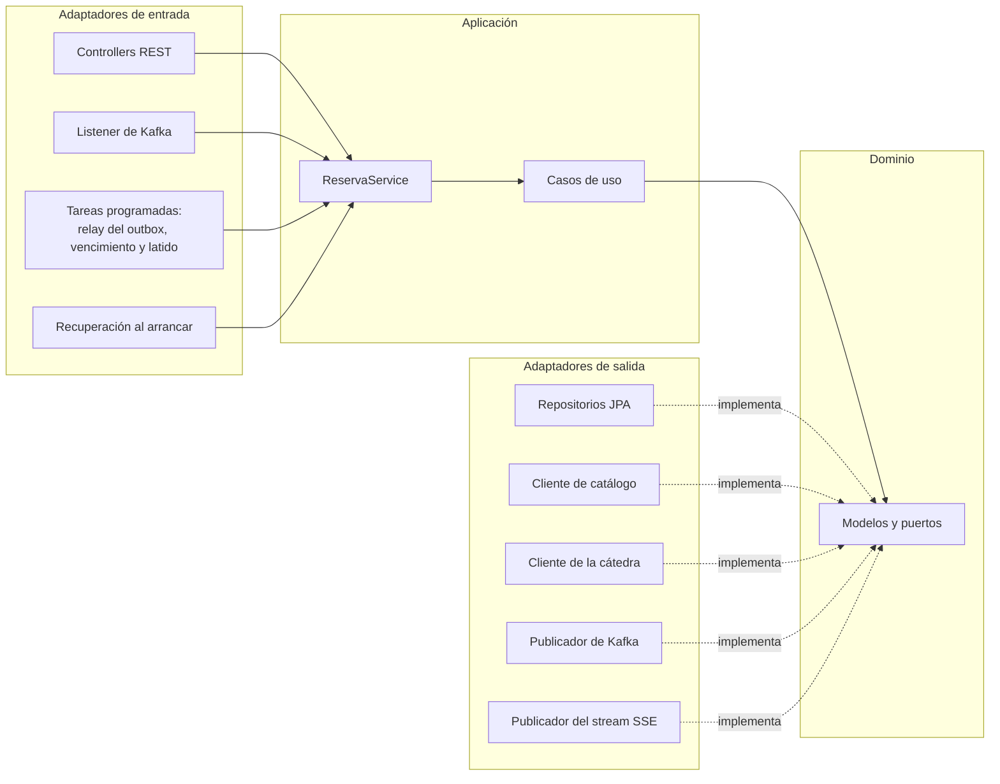

# Arquitectura

Este documento muestra el sistema completo (la aplicación Android, los dos servicios backend, sus bases de datos y las integraciones con la cátedra) y, después, cómo está organizado por dentro el servicio de turnos. El diagrama general es el mismo en el repositorio de catálogo.

## El sistema

El servicio de turnos guarda el proceso de cada reserva y lo lleva desde que el usuario elige un horario hasta que la cátedra lo confirma, lo rechaza o vence. Consulta a catálogo la agenda de los profesionales, le pide a la cátedra los bloqueos y las confirmaciones, y le avisa a la aplicación cada cambio.

### Reglas que respeta

- La aplicación Android nunca habla con la cátedra ni conoce el JWT técnico: todo pasa por los dos servicios.
- Cada servicio es dueño exclusivo de su base, con su propia instancia de PostgreSQL y sus propias migraciones. No hay claves foráneas ni accesos cruzados entre las dos bases; ver [modelo-de-datos.md](modelo-de-datos.md).
- Turnos no replica el catálogo: le pide a catálogo la agenda de un profesional cuando la necesita ([contrato.md](contrato.md#lo-que-turnos-consume-de-catálogo), [decisión 007](decisiones/007-cliente-de-catalogo.md)).
- Catálogo es el único que consume `CatalogUpdated` y el único que lee las claves `catedra:sync:*` de Redis.
- Turnos es el único que consume los eventos de reserva y el que publica el teléfono del paciente ([decisión 013](decisiones/013-consumer-de-eventos-de-la-catedra.md) y [decisión 014](decisiones/014-envio-del-telefono-con-outbox.md)).
- Los dos servicios usan la misma cuenta técnica de la cátedra, cargada por la variable de entorno `CATEDRA_JWT`.

### Dos identidades, dos JWT

El JWT de usuario lo emite catálogo y lo valida turnos con el mismo secreto ([decisión 002](decisiones/002-jwt-hs512-secreto-compartido.md), [seguridad.md](seguridad.md)). Turnos lo reenvía a catálogo con cada consulta, y con él identifica al dueño de cada reserva. El JWT técnico identifica a los dos servicios ante la cátedra y no viaja nunca a la aplicación: el dueño de la reserva llega a la cátedra como `externalPatientId`.

## El servicio de turnos por dentro

El servicio sigue la arquitectura hexagonal (puertos y adaptadores). Tiene un solo slice, `reserva`, con sus capas `domain`, `application` e `infrastructure`. Además, `shared` agrupa lo que no pertenece al slice: la configuración, la seguridad y el manejo de errores web.

- **Dominio** (`domain`): los modelos (la reserva y sus estados, los horarios, los eventos de la cátedra) y los puertos de entrada (un caso de uso por interfaz) y de salida. No importa Spring.
- **Aplicación** (`application`): los casos de uso y `ReservaService`, que los expone a los adaptadores de entrada. Los casos de uso no escriben logs: lo hace quien los dispara ([decisión 022](decisiones/022-logs-en-json-con-campos.md)).
- **Adaptadores de entrada** (`infrastructure`): los controllers (`web`), `CatedraEventListener` (`kafka`), `OutboxRelayScheduler`, `ExpirationScheduler` y `StreamHeartbeatScheduler` (`scheduling`) y `RecoveryRunner` (`startup`). Todos llaman a `ReservaService` y ninguno contiene lógica de negocio. Una excepción consciente: `ReservationStreamController` usa directamente el registro de conexiones SSE, porque administrar conexiones abiertas es transporte y no lógica de negocio ([decisión 015](decisiones/015-stream-de-cambios-sse.md)).
- **Adaptadores de salida** (`infrastructure`): la persistencia JPA (`persistence`), `CatalogClientAdapter` y `CatedraApiClientAdapter` (`client`), `KafkaPhonePublisher` (`kafka`) y `SseReservationChangePublisher` (`sse`).

Las decisiones de cada pieza están en [decisiones/](decisiones/README.md): los clientes de catálogo ([007](decisiones/007-cliente-de-catalogo.md)) y de la cátedra ([008](decisiones/008-cliente-de-la-catedra.md)), la máquina de estados ([010](decisiones/010-maquina-de-estados.md)), el consumidor de eventos ([013](decisiones/013-consumer-de-eventos-de-la-catedra.md)), el outbox ([014](decisiones/014-envio-del-telefono-con-outbox.md)), el stream SSE ([015](decisiones/015-stream-de-cambios-sse.md)), el vencimiento ([016](decisiones/016-vencimiento-de-procesos.md)) y la recuperación al arrancar ([017](decisiones/017-recuperacion-al-arrancar.md)).

## Cómo se ejecuta

Cada repositorio trae su `docker-compose.yml` con su propia base y se levanta por separado. Los pasos están en el [README](../README.md).
