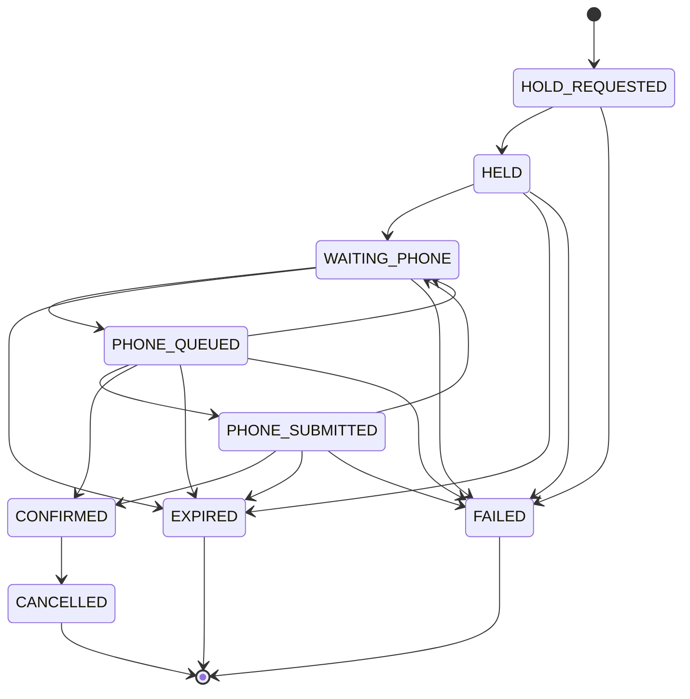

# Contrato del servicio de turnos

Lo consume la **aplicación Android**. Con el servicio en ejecución, `/swagger-ui.html` es la interfaz interactiva para probar los endpoints y `/v3/api-docs` es el documento OpenAPI en JSON del que sale; ambos se generan a partir del código. Este documento explica el contrato en lenguaje llano, incluye la máquina de estados que ve la aplicación y describe lo que turnos [consume de catálogo](#lo-que-turnos-consume-de-catálogo).

## Convenciones

- Todas las rutas empiezan con `/api`. El JSON usa `camelCase`.
- Fechas `yyyy-MM-dd`, instantes ISO-8601 en UTC y horas `HH:mm:ss`. Las horas de un turno son **locales de atención, sin zona horaria**, como las informa la cátedra; la zona con la que se decide qué horarios ya pasaron es `America/Argentina/Mendoza` por defecto.
- La lista de reservas se pagina al estilo de JHipster: `page` (desde 0) y `size`. La respuesta es un **arreglo JSON** y el total y los enlaces van en las cabeceras `X-Total-Count` y `Link` (`first`, `prev`, `next`, `last`). `size` vale 20 por defecto y 100 como máximo: un valor mayor se reduce al tope, no es un error.
- Los mensajes de `detail` están en español. El cliente decide por `status` y `code`, nunca por el texto.
- En local el servicio escucha en `http://localhost:8082` y sin HTTPS; en un entorno real habría que publicarlo detrás de HTTPS.

## Autenticación

Todo exige `Authorization: Bearer <jwt>` salvo `GET /actuator/health` y la documentación de la API.

**Turnos no emite tokens: valida el que emite catálogo** con el mismo secreto (HMAC **HS512**, [decisión 002](decisiones/002-jwt-hs512-secreto-compartido.md)). El token tiene que traer `uid` (el id del usuario), `auth` (sus autoridades) y `exp`, el vencimiento ([decisión 003](decisiones/003-claims-obligatorios-uid-y-auth.md) y [decisión 020](decisiones/020-claim-exp-obligatorio.md)). El usuario de cada pedido sale **siempre** del claim `uid`, nunca del cuerpo ni de la URL: por eso no hay forma de pedir las reservas de otro.

Un token ausente, mal formado, vencido, sin `exp`, `uid` o `auth`, o firmado con otra clave recibe el mismo `401 UNAUTHORIZED`: no se distingue el motivo ([decisión 005](decisiones/005-respuestas-401-y-403.md)). Los detalles de seguridad están en [seguridad.md](seguridad.md).

## La reserva

Todas las operaciones sobre reservas devuelven este objeto. `id` es el de la API: es el que se usa en las rutas. Nunca trae el usuario dueño ni los ids internos del bloqueo.

```json
{
  "id": 1,
  "reservationProcessId": "process-1",
  "status": "WAITING_PHONE",
  "professionalId": 15,
  "professionalFirstName": "Ana",
  "professionalLastName": "Gomez",
  "appointmentDate": "2026-10-19",
  "startTime": "09:30:00",
  "endTime": "10:00:00",
  "expiresAt": "2026-10-12T13:20:01Z",
  "patientPhone": null,
  "failureReason": null,
  "cancellationReason": null,
  "canSubmitPhone": false,
  "createdAt": "2026-10-12T13:10:00Z",
  "updatedAt": "2026-10-12T13:10:00Z"
}
```

| Campo | Significado |
|---|---|
| `id` | identificador de la reserva |
| `reservationProcessId` | id del proceso en la cátedra; `null` hasta que la cátedra responde el pedido del bloqueo |
| `status` | el estado, ver abajo |
| `professionalId`, `professionalFirstName`, `professionalLastName` | el profesional, tal como era al reservar |
| `appointmentDate`, `startTime`, `endTime` | el turno, en hora local de atención |
| `expiresAt` | hasta cuándo se mantiene el bloqueo o la espera del teléfono. Solo viene en `HELD`, `WAITING_PHONE`, `PHONE_QUEUED` y `PHONE_SUBMITTED`; en el resto es `null` (una reserva confirmada ya no vence). La app lo compara con la hora para mostrar el tiempo que queda |
| `patientPhone` | el teléfono, después de enviarlo, normalizado (solo dígitos y un `+` opcional) |
| `failureReason`, `cancellationReason` | cómo terminó una reserva fallida o vencida, y el motivo que dio el usuario al cancelar |
| `canSubmitPhone` | `true` solo si la reserva espera el teléfono **y** la cátedra ya lo pidió. La app habilita el formulario con este campo; si la cátedra rechaza el número, vuelve a ser `true` |
| `createdAt`, `updatedAt` | creación y último cambio |

### Estados



| Estado | Qué significa para la app |
|---|---|
| `HOLD_REQUESTED` | se está pidiendo el bloqueo del horario a la cátedra; dura lo que tarda `POST /api/reservations` |
| `HELD` | el horario está bloqueado y falta confirmarlo; también dura lo que tarda el `POST` |
| `WAITING_PHONE` | la reserva espera el teléfono del paciente. `POST /api/reservations` responde en este estado. Con `canSubmitPhone` en `true` se puede enviar |
| `PHONE_QUEUED` | el teléfono se recibió y está por enviarse a la cátedra |
| `PHONE_SUBMITTED` | el teléfono se envió; se espera que la cátedra confirme o lo rechace |
| `CONFIRMED` | el turno está confirmado. Es el único estado desde el que se puede cancelar |
| `CANCELLED`, `EXPIRED`, `FAILED` | finales: la reserva terminó y ya no cambia |

El estado solo avanza: un aviso tardío o repetido de la cátedra nunca hace retroceder una reserva. La única vuelta atrás es de `PHONE_QUEUED` o `PHONE_SUBMITTED` a `WAITING_PHONE`, cuando la cátedra rechaza el teléfono. Las reglas completas están en [maquina-de-estados.md](maquina-de-estados.md).

## Operaciones

### Disponibilidad

#### `GET /api/availability`

Los horarios libres de un profesional entre dos fechas: su agenda, menos lo que la cátedra informa como ocupado (`HELD` o `CONFIRMED`) y sin los horarios que ya pasaron. Es una foto: el veredicto real lo da el bloqueo al reservar ([decisión 009](decisiones/009-disponibilidad.md)).

| Parámetro | Descripción |
|---|---|
| `professionalId` | id del profesional |
| `from`, `to` | primer y último día, ambos incluidos (`yyyy-MM-dd`); `to` no puede ser anterior a `from` y el rango no puede pasar de 31 días |

```json
{
  "professionalId": 15,
  "from": "2026-10-19",
  "to": "2026-10-19",
  "slots": [
    { "date": "2026-10-19", "startTime": "09:00:00", "endTime": "09:30:00" },
    { "date": "2026-10-19", "startTime": "10:30:00", "endTime": "11:00:00" }
  ]
}
```

Errores: `400 INVALID_DATE_RANGE` (rango invertido o de más de 31 días), `400 BAD_REQUEST` (falta un parámetro o no tiene el formato), `400 PROFESSIONAL_DISABLED` (el profesional o su categoría están deshabilitados), `404 PROFESSIONAL_NOT_FOUND`, `503 CATALOG_UNAVAILABLE` y `503 CATEDRA_UNAVAILABLE`. Si cualquiera de los dos servicios falla no se devuelve una disponibilidad parcial.

### Reservas

#### `POST /api/reservations`

Inicia una reserva: valida el horario con catálogo, pide a la cátedra que lo bloquee y lo confirma ([decisión 011](decisiones/011-iniciar-una-reserva.md)). Devuelve la reserva esperando el teléfono. El usuario sale del token.

```json
{ "professionalId": 15, "date": "2026-10-19", "startTime": "09:30" }
```

La respuesta es `201` con la [reserva](#la-reserva) en `WAITING_PHONE`.

| HTTP | `code` | Cuándo |
|---|---|---|
| 400 | `VALIDATION_ERROR` | falta `professionalId`, `date` o `startTime`, o tienen un formato inválido |
| 400 | `PROFESSIONAL_DISABLED` | el profesional o su categoría están deshabilitados |
| 400 | `INVALID_SLOT` | el horario no está en la agenda del profesional o ya pasó |
| 400 | `PATIENT_NAME_REQUIRED` | la cuenta no tiene nombre y apellido de al menos 2 caracteres: la app los pide y reintenta |
| 404 | `PROFESSIONAL_NOT_FOUND` | el profesional no existe |
| 409 | `SLOT_UNAVAILABLE` | el horario ya está ocupado o bloqueado por otro |
| 409 | `RESERVATION_EXPIRED` | el bloqueo venció antes de confirmarse y los reintentos se agotaron |
| 409 | `RESERVATION_CONFLICT` | otra operación modificó la reserva más veces de las que se reintenta: consultar su estado antes de repetir |
| 503 | `CATALOG_UNAVAILABLE`, `CATEDRA_UNAVAILABLE` | un servicio no responde; no se inicia nada que necesite información vigente |

#### `GET /api/reservations`

Las reservas del usuario, de la más reciente a la más antigua por fecha y hora del turno (el orden es fijo y `sort` se ignora).

| Parámetro | Descripción |
|---|---|
| `status` | solo las reservas en ese estado; sin valor, todas menos las `EXPIRED` y las `FAILED` (son los intentos que no llegaron a ser una reserva). Con `status` se devuelven exactamente las de ese estado, también `FAILED` o `EXPIRED` |
| `page`, `size` | paginación |

La respuesta es un arreglo de [reservas](#la-reserva) con `X-Total-Count` y `Link` ([decisión 012](decisiones/012-consulta-y-cancelacion.md)).

#### `GET /api/reservations/{id}`

Una reserva del usuario. Una reserva **ajena** responde `404 RESERVATION_NOT_FOUND` con el mismo cuerpo que una inexistente, para no revelar que existe.

#### `POST /api/reservations/{id}/phone`

Envía el teléfono del paciente. Solo se acepta con la reserva en `WAITING_PHONE` y el pedido de la cátedra ya recibido (`canSubmitPhone` en `true`).

```json
{ "phoneNumber": "+54 9 261 555-1234" }
```

El número se normaliza (se quitan espacios, guiones, paréntesis y puntos) y debe quedar entre 7 y 15 dígitos con un `+` opcional; se envía tal cual, sin completar el código de país ([decisión 014](decisiones/014-envio-del-telefono-con-outbox.md)). La respuesta es `202` con la reserva en `PHONE_QUEUED`: el resultado final llega después, cuando la cátedra confirma o rechaza, y la app lo sabe por el [stream](#get-apireservationsstream) o consultando.

| HTTP | `code` | Cuándo |
|---|---|---|
| 400 | `VALIDATION_ERROR` | falta el teléfono o no tiene entre 7 y 15 dígitos |
| 404 | `RESERVATION_NOT_FOUND` | la reserva no existe o es de otro usuario |
| 409 | `INVALID_RESERVATION_STATE` | la reserva no espera el teléfono, la cátedra todavía no lo pidió o ya se envió uno |
| 409 | `RESERVATION_EXPIRED` | pasó el vencimiento: hay que iniciar otra reserva |
| 409 | `RESERVATION_CONFLICT` | como en el inicio |

#### `POST /api/reservations/{id}/cancel`

Cancela una reserva confirmada. El cuerpo es opcional:

```json
{ "reason": "No puedo asistir" }
```

`reason` admite hasta 500 caracteres. La respuesta es `200` con la reserva en `CANCELLED`. Cancelar una reserva que ya está cancelada devuelve su estado actual, sin error.

| HTTP | `code` | Cuándo |
|---|---|---|
| 400 | `VALIDATION_ERROR` | el motivo pasa de 500 caracteres |
| 404 | `RESERVATION_NOT_FOUND` | la reserva no existe o es de otro usuario |
| 409 | `RESERVATION_NOT_CANCELLABLE` | la reserva no está confirmada (ni cancelada) |
| 409 | `RESERVATION_CONFLICT` | como en el inicio; la cancelación pudo haber llegado a la cátedra, así que se consulta el estado antes de repetir |
| 503 | `CATEDRA_UNAVAILABLE` | la cátedra no responde; la reserva no cambia |

### Cambios en tiempo real

#### `GET /api/reservations/stream`

Abre una conexión `text/event-stream` por la que el servidor avisa cada cambio de las reservas **del usuario del token** ([decisión 015](decisiones/015-stream-de-cambios-sse.md)). Es una optimización y no la fuente de verdad: al conectar o reconectar, la app consulta `GET /api/reservations` y refresca.

```
:ping

event:reservation-updated
id:1-5
data:{"id":1,"status":"WAITING_PHONE","expiresAt":"2026-10-12T13:20:01Z","canSubmitPhone":true,"updatedAt":"2026-10-12T13:10:03Z"}
```

- **Qué avisa.** Cada cambio de estado y la llegada del pedido de teléfono, que no cambia el estado pero pone `canSubmitPhone` en `true`. Crear la reserva no avisa: la respuesta del `POST` ya la trae.
- **`data`.** Un resumen (`id`, `status`, `expiresAt`, `canSubmitPhone`, `updatedAt`); el detalle se pide con `GET /api/reservations/{id}`. El `id` del evento es `{reserva}-{versión}`.
- **Después de guardar.** El aviso sale cuando el cambio ya quedó guardado, así que al recibirlo la consulta lo ve.
- **Sin historia.** Un aviso perdido no se reenvía y `Last-Event-ID` se ignora.
- **Latido.** Un comentario `:ping` al conectar y cada 25 segundos (por defecto). El cliente lo ignora.
- **Token vencido.** El servidor cierra el stream en el primer latido posterior al vencimiento. Como la cabecera `200` ya se envió, no puede ser un `401`: la app lo nota porque el stream termina, y renueva el token antes de reconectar.
- **Límite.** Hasta 5 conexiones por usuario (por defecto): al abrir una más se cierra la más vieja.

## Errores

Todos los errores salen como `application/problem+json`, con el mismo formato que usa la cátedra:

```json
{
  "detail": "La reserva no existe",
  "instance": "/api/reservations/99",
  "status": 404,
  "title": "Not Found",
  "path": "/api/reservations/99",
  "code": "RESERVATION_NOT_FOUND"
}
```

`instance` lo agrega Spring con el mismo valor que `path`; los clientes pueden ignorarlo. Los `401` y `403` los escribe el filtro de seguridad, antes de llegar a Spring MVC, y no lo traen. Los errores de validación suman `fieldErrors`:

```json
{
  "detail": "Los datos enviados no son válidos",
  "instance": "/api/reservations/1/phone",
  "status": 400,
  "title": "Bad Request",
  "path": "/api/reservations/1/phone",
  "code": "VALIDATION_ERROR",
  "fieldErrors": [
    {
      "objectName": "submitPhoneRequest",
      "field": "phoneNumber",
      "message": "phoneNumber debe tener entre 7 y 15 dígitos, con un + opcional al principio"
    }
  ]
}
```

| HTTP | `code` | Cuándo |
|---|---|---|
| 400 | `VALIDATION_ERROR` | el cuerpo no es un JSON válido o no cumple las restricciones; trae `fieldErrors` salvo con un JSON mal formado |
| 400 | `BAD_REQUEST` | una solicitud que Spring rechaza antes del controller, como un parámetro de tipo equivocado o que falta |
| 400 | `INVALID_DATE_RANGE`, `PROFESSIONAL_DISABLED`, `INVALID_SLOT`, `PATIENT_NAME_REQUIRED` | ver cada operación |
| 401 | `UNAUTHORIZED` | falta el token, o está vencido, mal formado, sin `exp`, `uid` o `auth`, o firmado con otra clave |
| 403 | `FORBIDDEN` | autenticado, pero sin permiso para la operación |
| 404 | `PROFESSIONAL_NOT_FOUND`, `RESERVATION_NOT_FOUND` | el recurso no existe (o la reserva es ajena) |
| 404 | `NOT_FOUND` | la ruta no existe |
| 405 | `METHOD_NOT_ALLOWED` | el método HTTP no está permitido para la ruta |
| 406 | `NOT_ACCEPTABLE` | el formato de respuesta pedido no está disponible |
| 409 | `SLOT_UNAVAILABLE`, `RESERVATION_EXPIRED`, `RESERVATION_NOT_CANCELLABLE`, `INVALID_RESERVATION_STATE`, `RESERVATION_CONFLICT` | ver cada operación |
| 415 | `UNSUPPORTED_MEDIA_TYPE` | el `Content-Type` no está soportado |
| 500 | `INTERNAL_ERROR` | un error inesperado, incluido un desajuste con catálogo o con la cátedra; el detalle es genérico a propósito, sin mensajes internos |
| 503 | `CATALOG_UNAVAILABLE` | catálogo no responde |
| 503 | `CATEDRA_UNAVAILABLE` | la cátedra no responde |
| 503 | `DATABASE_UNAVAILABLE` | no hay conexión con la base de datos |

Los reintentos, los tiempos de espera y qué sigue funcionando con cada servicio caído están en [resiliencia.md](resiliencia.md).

## Lo que turnos consume de catálogo

Turnos llama a catálogo con el **JWT del usuario**, el mismo que recibió: cada pedido reenvía su `Authorization` ([decisión 007](decisiones/007-cliente-de-catalogo.md)). Solo usa dos operaciones:

- `GET /api/professionals/{id}`: la agenda vigente. Lee `id`, `categoryId`, `categoryName`, `categoryEnabled`, `firstName`, `lastName` y `enabled` del profesional y, de cada horario, `id`, `dayOfWeek`, `startTime`, `endTime`, `slotDurationMinutes` y `enabled`. Con eso calcula los turnos libres y no ofrece horarios de un profesional ni de una categoría deshabilitados.
- `GET /api/account`: lee `firstName` y `lastName` del paciente al iniciar una reserva.

Las reglas del acuerdo entre los dos servicios:

- **Compatibilidad.** Catálogo puede agregar campos a una respuesta sin avisar: turnos ignora los que no conoce. Lo que no puede hacer es quitar un campo, cambiarle el nombre, el tipo o el significado. Si turnos no recibe `categoryEnabled` lo trata como un desajuste entre los servicios y responde `500`, en lugar de suponer un valor.
- **Errores.** Un `404` en `GET /api/professionals/{id}` es un profesional que no existe y turnos responde `404 PROFESSIONAL_NOT_FOUND`. Un `5xx`, un timeout o una conexión caída se reintentan (3 intentos en total, con una espera que se duplica) y, si se agotan, turnos responde `503 CATALOG_UNAVAILABLE` y no inicia operaciones nuevas. Cualquier otro `4xx` (por ejemplo un `401` por un secreto distinto) o un cuerpo ilegible es un desajuste entre los servicios: no se reintenta y turnos responde `500`.
- **Identidad.** Catálogo valida el token que turnos le reenvía con el mismo secreto. Los dos servicios exigen que traiga `exp`, `uid` y `auth`.

## Lo que turnos usa de la cátedra

Turnos habla con la API de la cátedra con el **JWT técnico** del proyecto, que nunca llega a la aplicación ([decisión 008](decisiones/008-cliente-de-la-catedra.md)). Usa cinco operaciones: las ocupaciones de un profesional, crear un bloqueo, confirmarlo, listar las reservas y cancelar. Los eventos de la cátedra llegan por Kafka y el teléfono del paciente sale por Kafka ([idempotencia-y-recuperacion.md](idempotencia-y-recuperacion.md)).
