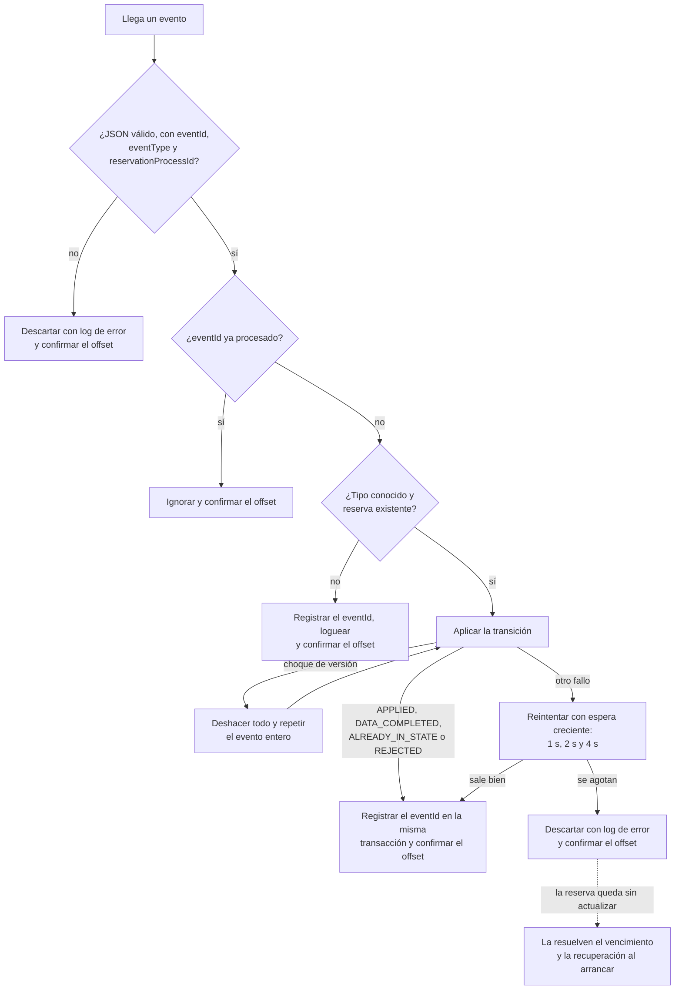

# Idempotencia y recuperación

Kafka entrega cada evento de la cátedra **al menos una vez**: puede llegar repetido, fuera de orden o no llegar. La cátedra, además, no tiene idempotencia al crear un bloqueo de horario y un timeout no prueba que la operación haya fallado. Este documento explica qué hace el servicio en cada caso y por qué una reserva termina siempre en un estado coherente. Las reglas de la máquina de estados están en [maquina-de-estados.md](maquina-de-estados.md) y los reintentos y timeouts, en [resiliencia.md](resiliencia.md).

## Cinco principios

1. **Un solo lugar cambia el estado.** Todo paso (un evento de Kafka, el relay, el vencimiento, la recuperación, y las acciones del usuario) pasa por el mismo caso de uso. Responde `APPLIED`, `DATA_COMPLETED`, `ALREADY_IN_STATE` o `REJECTED`, nunca una excepción por un paso inválido: un evento tardío o repetido no hace fallar al consumidor ([decisión 010](decisiones/010-maquina-de-estados.md)).
2. **El estado solo avanza.** Un estado final no se reabre y la tabla de transiciones rechaza todo retroceso, salvo el rechazo del teléfono por la cátedra.
3. **Estado y `eventId` cambian juntos o no cambian.** Aplicar el evento y guardar su `eventId` en `processed_events` es una sola transacción ([decisión 013](decisiones/013-consumer-de-eventos-de-la-catedra.md)). Igual el envío del teléfono: el estado y el mensaje del outbox se guardan juntos ([decisión 014](decisiones/014-envio-del-telefono-con-outbox.md)).
4. **El offset de Kafka se confirma al final**, después del `COMMIT`. Si el servicio cae antes, Kafka reentrega el evento y el `eventId` evita repetir el efecto.
5. **Bloqueo optimista.** Cada reserva lleva una `version`: si dos operaciones la modifican a la vez, la segunda relee y decide de nuevo sobre el estado vigente. Con dos instancias, la segunda ve `ALREADY_IN_STATE`.

## Qué pasa con un evento de la cátedra

- **Se ignoran y se registran**, para no trabar la lectura de los que siguen: un evento repetido (`DUPLICATE`), de una reserva que no existe, de un tipo que no se trata o un paso que el diagrama no permite desde el estado actual. Reentregarlos no los arregla.
- **Un mensaje que no se puede interpretar** (JSON inválido, sin `eventId`, `eventType` o `reservationProcessId`) se descarta sin reintentos.
- **Los reintentos** son `CATEDRA_KAFKA_MAX_RETRIES` (3 por defecto) con espera inicial `CATEDRA_KAFKA_INITIAL_BACKOFF` (1 segundo), que se duplica. Agotados, el mensaje se descarta y se sigue; no hay cola de eventos muertos: una reserva que se quede sin su evento la recupera la reconciliación.
- **El choque de versión** se reintenta por fuera de la transacción: dentro de una abierta, un fallo de versión la marca para deshacer y releer no sirve. Es seguro porque el registro del `eventId` se deshizo con el resto.

## Mensajes duplicados

- **Eventos de Kafka.** El `eventId` se comprueba en `processed_events` y su clave primaria rechaza a un repetido, también si dos corren a la vez. Si el servicio cae entre el `COMMIT` y la confirmación del offset, el evento se reentrega y ya figura procesado.
- **El teléfono hacia la cátedra.** Un mensaje sin confirmación de Kafka queda `PENDING` y se reenvía con el **mismo `eventId` y contenido**. Si el relay cae entre la confirmación y el marcado como `SENT`, se reenvía igual y la cátedra lo descarta como duplicado.
- **Repetir un pedido de la app.** Cancelar una reserva ya cancelada devuelve su estado, sin llamar a la cátedra. Enviar el teléfono dos veces responde `409 INVALID_RESERVATION_STATE`, porque la reserva ya no espera el teléfono. Confirmar un hold ya confirmado es la misma reserva: la cátedra responde `RESERVATION_PROCESS_ALREADY_CONFIRMED` y el flujo sigue ([decisión 011](decisiones/011-iniciar-una-reserva.md)).
- **Doble clic al reservar.** No hay una restricción local sobre el horario: la cátedra responde `409` al segundo bloqueo y se informa `SLOT_UNAVAILABLE`. Un `409` nunca se toma como «ese hold es mío».

## Mensajes perdidos

| Qué se pierde | Qué pasa |
| --- | --- |
| Un evento de la cátedra (se agotaron los reintentos, o el servicio estuvo caído y el grupo avanzó) | La reserva queda sin actualizar hasta que la cierra el **vencimiento** (que antes le pregunta a la cátedra si ya la tiene confirmada) o la **recuperación al arrancar** |
| El teléfono hacia la cátedra | Queda `PENDING` en el outbox y el relay lo reintenta en cada vuelta mientras Kafka no confirme |
| La respuesta del bloqueo del horario | El intento queda `FAILED` (`HOLD_RESULT_UNKNOWN`) y antes de pedir otro se consultan las ocupaciones: si el horario figura ocupado se responde `409` sin asumir que el hold es nuestro; si figura libre, se pide otro. El hold que haya creado la cátedra vence solo |
| La respuesta de la confirmación | La reserva queda en `HELD`, con sus ids, y se responde `503`. `HELD` no es final: el vencimiento o la reconciliación la resuelven |

## Mensajes fuera de orden

- **Un evento tardío después de un estado final** se ignora y se registra: `EXPIRED`, `FAILED` y `CANCELLED` no cambian, y `CONFIRMED` solo puede pasar a `CANCELLED`. Por eso el vencimiento espera un margen y pregunta antes de expirar.
- **La cátedra contesta antes de que el relay anote el envío.** Desde `PHONE_QUEUED` también se aceptan `CONFIRMED` y `WAITING_PHONE`, y el paso posterior del relay a `PHONE_SUBMITTED` se rechaza sin retroceder nada, aunque el mensaje igual queda `SENT`.
- **El pedido de teléfono llega antes de que el `POST` guarde `WAITING_PHONE`.** La transición completa los datos que faltan (el `requestEventId`) sin pisar los que hay, y el `POST` trata «ya estaba en el estado pedido» como correcto.

## Recuperación tras un reinicio

Una vez, al terminar de arrancar (`ApplicationReadyEvent`), el servicio revisa lo que una caída pudo dejar a medias, con una tanda acotada de cada clase (`RECOVERY_BATCH_SIZE`, 100 por defecto) ([decisión 017](decisiones/017-recuperacion-al-arrancar.md)):

- **Pedidos de bloqueo sin resultado.** Los procesos en `HOLD_REQUESTED` sin `holdId` ni `reservationProcessId`, creados **antes de que arrancara esta instancia**, pasan a `FAILED` con `HOLD_RESULT_UNKNOWN`. La guarda por hora existe porque el servidor ya atiende pedidos cuando se dispara la recuperación y un pedido en curso se parecería a uno huérfano. El hold que la cátedra haya creado vence solo.
- **Reservas con el teléfono ya enviado.** Los procesos en `PHONE_QUEUED` y `PHONE_SUBMITTED` se comparan con las reservas confirmadas del paciente que informa la cátedra: los que ya figuran confirmados se reparan a `CONFIRMED`.
- **El outbox** no necesita un paso aparte: el relay retoma solo los mensajes `PENDING`.
- **Lo que no se toca.** Los `HELD` no se confirman de nuevo: recuperar no debe iniciar acciones con efectos sobre una reserva que el usuario ya vio fallar. Los resuelve el evento que Kafka reentrega o, si no, el vencimiento.

## Reconciliación con la cátedra

La pregunta «¿la cátedra lo tiene confirmado?» es la misma para el vencimiento y para la recuperación, y vive en un solo componente. Se hace con `GET /api/appointments` filtrando las reservas confirmadas del paciente **en el día del turno** ([decisión 023](decisiones/023-reconciliacion-por-fecha.md)) y buscando el proceso por su `reservationProcessId`.

- **Solo se actúa con evidencia.** Que el proceso no figure no prueba que haya que cerrarlo. Si la cátedra no responde, o devuelve más resultados que la página sin que aparezca el proceso, no se toca nada: ante la duda se espera.
- **El vencimiento** expira un proceso solo cuando su `expiresAt` pasó hace más que un margen (`RESERVATION_EXPIRATION_GRACE`, 60 s) y, para `PHONE_QUEUED` y `PHONE_SUBMITTED`, después de consultar ([decisión 016](decisiones/016-vencimiento-de-procesos.md)). Un `AppointmentConfirmed` que llegue después de expirado se descartaría, y por eso el margen y la consulta.
- **El evento y la tarea convergen.** Los dos llevan al mismo estado final y el segundo ve `ALREADY_IN_STATE`; hay pruebas que lanzan el vencimiento (y la recuperación) a la vez que una confirmación sobre el mismo proceso y comprueban que siempre queda consistente.

## Límites conocidos

- **Una sola instancia.** El relay del outbox y el registro de conexiones del stream no están pensados para varias instancias: dos relays podrían publicar el mismo teléfono, que la cátedra descarta por su `eventId`.
- **`processed_events` no se depura:** guarda una fila por evento y esas filas no se borran.
- **Un evento perdido puede tardar en corregirse.** Entre el `expiresAt` y el cierre pasan de 60 a 90 segundos, y con la cátedra caída las reservas con teléfono enviado esperan a que responda o al próximo arranque.
- **Las cancelaciones perdidas.** La recuperación no compara las reservas `CONFIRMED` con las canceladas de la cátedra: un `AppointmentCancelled` perdido es muy raro porque Kafka lo retiene.
- **El tope de intentos del consumidor** descarta el mensaje: no hay cola de eventos muertos.
