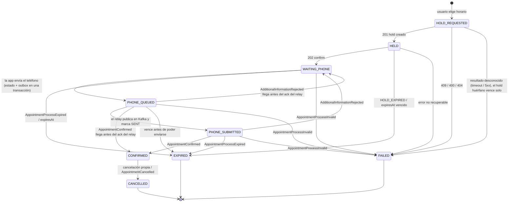

# Máquina de estados de la reserva

Cada reserva es un proceso local (tabla `reservation_processes`) que avanza por estos estados. REST y Kafka le informan lo que pasa en la cátedra y llegan en momentos distintos: por eso el proceso solo avanza, y un evento tardío o repetido nunca lo hace retroceder.

## Reglas

- **Vencimiento:** además del evento `AppointmentProcessExpired`, una tarea expira los procesos abiertos con `expiresAt` vencido hace más que un margen (60 s), con el motivo `HOLD_EXPIRED`. Antes de expirar uno en `PHONE_QUEUED` o `PHONE_SUBMITTED` le pregunta a la cátedra si ya lo tiene confirmado y, si es así, lo repara a `CONFIRMED`; ante la duda no expira (D91).
- **Recuperación al arrancar:** una vez, al terminar de levantar el servicio, los `HOLD_REQUESTED` sin ids creados antes de que arrancara la instancia pasan a `FAILED` (`HOLD_RESULT_UNKNOWN`) y los `PHONE_QUEUED` y `PHONE_SUBMITTED` que la cátedra tiene confirmados se reparan a `CONFIRMED`; lo demás no se toca (D92).
- **Estados finales:** `EXPIRED`, `FAILED` y `CANCELLED`. Son inmutables: ni un evento tardío ni uno duplicado los reabre. `CONFIRMED` solo puede pasar a `CANCELLED`.
- **Un solo lugar cambia el estado.** Todo paso pasa por un único caso de uso (`ApplyReservationTransitionUseCase`), que responde:
  - `APPLIED`: el estado cambió.
  - `DATA_COMPLETED`: el proceso ya estaba en el estado pedido pero le faltaban datos de los que trae el paso (por ejemplo, el `requestEventId` del pedido de teléfono, que llega cuando el proceso ya está en `WAITING_PHONE`). Se completan sin pisar los que ya tiene.
  - `ALREADY_IN_STATE`: el proceso ya estaba en el estado pedido y no hay nada que completar. Se mira antes que la tabla, y hace inocuo repetir un paso (un evento duplicado, una cancelación repetida). En un estado final nunca se completa nada.
  - `REJECTED`: el diagrama no permite ese paso desde el estado actual. Se ignora y se registra; no es un error ni retrocede nada.
- **Gana el estado más avanzado.** La cátedra puede contestar antes de que el relay anote que el teléfono se envió: por eso desde `PHONE_QUEUED` también se aceptan `CONFIRMED` y `WAITING_PHONE`. El relay, en cambio, solo pasa a `PHONE_SUBMITTED` desde `PHONE_QUEUED`; si el proceso ya avanzó, ese paso es `REJECTED`.
- **Bloqueo optimista.** Cada proceso lleva una `version`. Si dos operaciones lo modifican a la vez, la segunda recibe un conflicto, relee el proceso y decide de nuevo sobre el estado vigente, hasta `RESERVATION_CONFLICT_MAX_ATTEMPTS` intentos (3 por defecto). Agotados, la operación falla con un conflicto. El reintento no es válido dentro de una transacción ya abierta.
- **Respuesta perdida del hold:** la cátedra no tiene idempotencia ni permite recuperar los ids de un hold. Un proceso en `HOLD_REQUESTED` sin respuesta pasa a `FAILED`; antes de crear otro hold se consultan las ocupaciones del profesional, y si el horario aparece `HELD` se espera su `expiresAt` sin asumir que el hold es nuestro. Un `409` nunca se toma como «es mi hold».
- Cada proceso guarda el usuario dueño, el `reservationProcessId` y el `holdId` de la cátedra, el `requestEventId`, `expiresAt`, los datos del horario y los datos descriptivos del profesional al momento de reservar.

Las decisiones y las alternativas descartadas están en [decisiones.md](decisiones.md), entrada 10.
