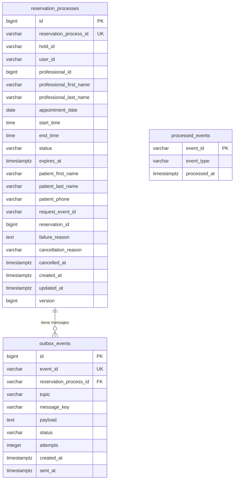

# Modelo de datos

El servicio de turnos tiene su propia instancia de PostgreSQL 18, con su base y su usuario. El esquema lo crean solo las migraciones de Flyway (`src/main/resources/db/migration`) y Hibernate corre con `ddl-auto=validate`, así que cualquier diferencia entre las entidades y las tablas impide arrancar ([decisión 006](decisiones/006-esquema-de-la-base-de-turnos.md)).

## Diagrama

`outbox_events` apunta al `reservation_process_id` de la cátedra, no al `id` propio, porque el mensaje que se publica lleva ese valor como clave. `processed_events` no tiene relaciones con el resto.

## Las tablas

### `reservation_processes`: la reserva

Una fila por cada intento de reservar. La app la ve como una reserva con su `id` ([contrato.md](contrato.md#la-reserva)); el resto de los campos es el proceso con la cátedra. Todos los cambios pasan por un único caso de uso, que respeta la [máquina de estados](maquina-de-estados.md).

- **El `id` y los ids de la cátedra.** El `id` lo genera la base: es el de la API. `reservation_process_id` y `hold_id` son de la cátedra y aceptan `NULL`: la fila se crea en `HOLD_REQUESTED` *antes* de llamar a la cátedra, y los ids llegan con la respuesta del hold. El `UNIQUE` sobre `reservation_process_id` evita reservas duplicadas, porque PostgreSQL permite varios `NULL` en una columna única.
- **El dueño y el profesional, por valor.** `user_id` es el `uid` del JWT (el `externalPatientId` que se manda a la cátedra) y `professional_id` es el id de la cátedra. Son datos históricos para mostrar la reserva: no hay claves foráneas porque viven en otros sistemas. Lo mismo vale para los nombres del profesional y del paciente, que se copian al reservar.
- **El horario.** `appointment_date`, `start_time` y `end_time` son horas locales de atención, sin zona horaria, como las informa la cátedra. Un `CHECK` exige que el turno termine después de empezar.
- **El estado.** `status` admite solo los nueve estados de la máquina, por un `CHECK`: un estado mal escrito no se puede guardar. Agregar uno exige una migración.
- **Datos opcionales.** `expires_at` (vencimiento del bloqueo o de la espera), `patient_phone` (se completa al enviarlo), `request_event_id` (el `eventId` del pedido de teléfono de la cátedra, que hay que devolver con el teléfono), `reservation_id` (el id de la reserva confirmada en la cátedra), `failure_reason` (el motivo con que terminó un intento fallido o vencido), `cancellation_reason` y `cancelled_at`.
- **Largos.** Los toma del contrato de la cátedra: 100 caracteres para `user_id` y los ids de la cátedra, 100 para el nombre y el apellido del paciente, 20 para el teléfono y 500 para el motivo de cancelación.
- **`version`.** Es el contador del bloqueo optimista: evita que una respuesta de REST y un evento de Kafka se pisen al modificar la misma fila a la vez. El perdedor relee y decide de nuevo.
- **Índices.** `user_id` (toda consulta y cancelación filtra por dueño) y `(status, expires_at)` (el vencimiento y la recuperación buscan procesos abiertos con vencimiento pasado).

### `outbox_events`: lo que hay que publicar

Los mensajes que el servicio debe mandar a Kafka (hoy, solo el teléfono del paciente). Se guardan en la misma transacción que el cambio de estado y un relay los publica ([decisión 014](decisiones/014-envio-del-telefono-con-outbox.md)).

- `status` es `PENDING` o `SENT`, con un `CHECK`; `attempts` cuenta los intentos de publicación y `sent_at` queda vacío hasta que Kafka confirma.
- `event_id` es único: es el identificador con el que la cátedra descarta un mensaje repetido. `message_key` guarda el mismo valor que `reservation_process_id`, la clave que exige la cátedra.
- El índice de `reservation_process_id` existe porque PostgreSQL no indexa las claves foráneas por su cuenta. Un índice **parcial** sobre `created_at` cubre solo las filas `PENDING`, que es lo único que lee el relay: las ya enviadas no pesan.

### `processed_events`: la deduplicación

El `eventId` de cada evento de Kafka ya procesado. Se guarda en la misma transacción que el efecto del evento, y su clave primaria rechaza un evento repetido ([idempotencia-y-recuperacion.md](idempotencia-y-recuperacion.md)). También se guardan los eventos que se ignoran, para no reabrirlos.

## Propiedad de los datos

| Dato | Quién es el dueño | Qué hace este servicio |
|---|---|---|
| Usuarios, contraseñas y roles | Catálogo | Nada: solo valida el JWT que catálogo emite |
| Categorías, profesionales y horarios | La cátedra, por medio de catálogo | No los guarda: le pide a catálogo la agenda cuando la necesita |
| Holds y reservas confirmadas | La cátedra (fuente de verdad) | Guarda el proceso local con sus ids y lo actualiza con lo que informa la cátedra |
| El proceso de cada reserva, el outbox y los eventos procesados | Turnos | Los crea y los modifica |

La delimitación con catálogo es total:

- Los dos servicios tienen instancias de PostgreSQL distintas: ninguno lee ni escribe la base del otro, y no hay claves foráneas entre ellas.
- Turnos guarda al usuario y al profesional **por valor**, sin clave foránea, y los ids de la cátedra (proceso, bloqueo y reserva) como texto o número sin integridad referencial hacia ningún sistema.
- Lo que turnos necesita de catálogo lo pide por REST con el JWT del usuario: la agenda de un profesional y el nombre del paciente ([contrato.md](contrato.md#lo-que-turnos-consume-de-catálogo)).
- Las credenciales de los usuarios no llegan a esta base: turnos nunca ve una contraseña ni un hash. Lo que guarda del paciente (nombre, apellido y teléfono) no se escribe nunca en un log ([decisión 019](decisiones/019-logs-sin-secretos.md)).

## Migraciones

| Versión | Qué hace |
|---|---|
| `V1__crear_esquema_turnos` | `reservation_processes`, `outbox_events` y `processed_events`, con sus restricciones e índices |

Una migración ya aplicada no se edita: un cambio de esquema es una migración nueva.
